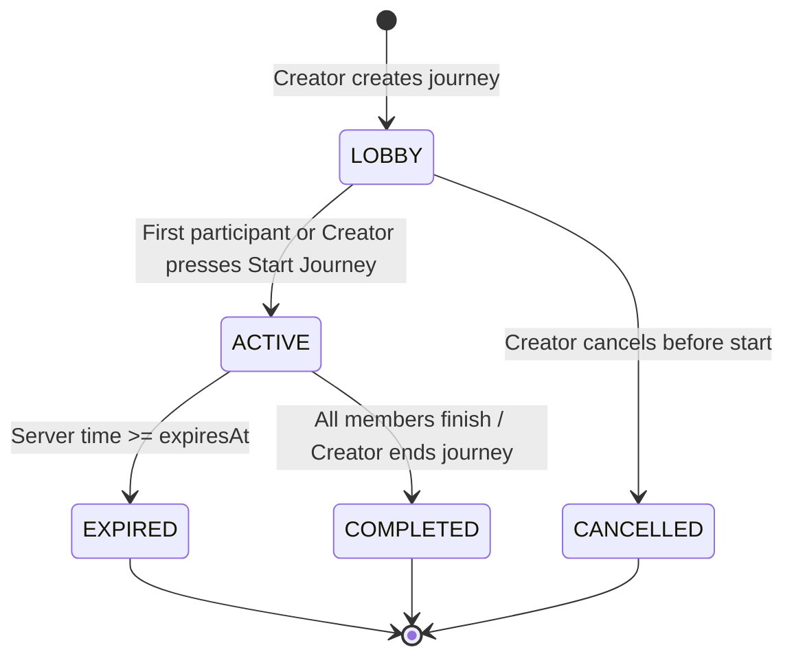
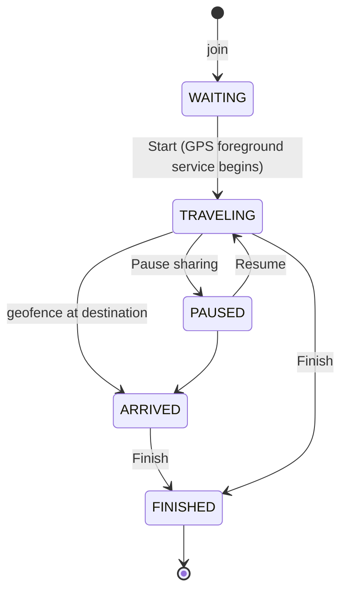

# SyncPoint Architecture & System Design

## 1. System Overview

SyncPoint is built on a "Journey, not tracking" paradigm. Location sharing is activated only inside an active journey, converging on one common destination.

```
                          +-----------------------+
                          |      Firebase         |
                          |-----------------------|
                          | Anonymous Auth        |
                          | Realtime Database     |
                          | App Check             |
                          +-----------+-----------+
                                      ^
                                      | live state / journey events
            +-------------------------+-------------------------+
            |                         |                         |
     +------+------+           +------+------+           +------+------+
     |  Traveler A |           |  Traveler B |           |  Traveler C |
     |  React Ntv  |           |  React Ntv  |           |  React Ntv  |
     |  MapLibre   |           |  MapLibre   |           |  MapLibre   |
     |  Kotlin FGS |           |  Kotlin FGS |           |  Kotlin FGS |
     +------+------+           +------+------+           +------+------+
            |                         |                         |
            +-------------------------+-------------------------+
                                      |
                                      v
                            +-------------------+
                            |  OSRM Routing API |
                            |  (Car/Bike/Walk)  |
                            +-------------------+
```

---

## 2. Journey State Machine



### Participant (traveler) lifecycle

Defined once in `src/domain/travelerState.ts` and enforced again by the database rules.
The UI derives "not started / on the way / arrived" **only** from this state, never from distance.


Leaving a journey removes the member record (and frees the seat).

---

## 3. Application layers (Phase 1 foundation)

```
screens (src/features/*)            thin UI; read stores, call actions
   │
navigation (src/app/navigation)     React Navigation native stack; hardware back; resume on launch; invite links
   │
tracking (src/tracking)             trackingController = GPS fixes -> route progress/ETA/voice/arrival -> publish (runs with no screen open)
   │                                journeyTracking = Start flow (permission, real GPS fix, state change) + resume after restart
session (src/session)               journeySession  = the ONE live subscription (meta, members, live) + "journey ended for me" detection
   │                                journeyActions  = create / join / start / finish / leave / end (repo + session + store)
data (src/data)                     journeyRepository, userJourneyRepository: the only code that writes journey data
   │                                paths.ts (schema), serialization.ts, serverClock.ts, errors.ts
domain (src/domain)                 pure, unit-tested rules: traveler state machine, seats, join codes, ownership, invite links,
                                    route progress (distance along the road), ETA, arrival detector, participant view model
```

* The native Kotlin service (Fused Location) attaches the device's real battery % and charging state to every fix and
  speaks turn prompts through Android TextToSpeech. Sampling/publish gating lives only in Kotlin (`AdaptiveSamplingPolicy`).
* Published `lastUpdatedAt` is the Firebase server timestamp, so "last seen" is right on any phone clock.
* **Offline behaviour.** Firebase's own connection state (`.info/connected`) drives an "offline" banner. While offline the
  phone keeps navigating and recording its track (SQLite, survives the app being killed); on reconnect it publishes its
  *latest* position (old positions are never replayed) and sends chat typed offline from a durable outbox.
* **Offline maps** are real MapLibre offline packs sized from the actual route (capped at 5,500 tiles; long routes get less
  street-level detail).
* **Alerts without push.** The session diffs members / live data and shows "X arrived / needs help / low battery" as an in-app
  banner, or as an Android notification when the app is in the background (the tracking service keeps it alive on a trip).
* **Routing / search.** OpenRouteService -> public OSRM -> a clearly labelled straight-line estimate; Geoapify -> LocationIQ,
  with per-device daily rationing so the shared free quotas last. Keys are read from `.env`.
* Zustand stores are read-only mirrors of the live session; they are not a second source of truth.
* Identity is the Firebase anonymous UID (persisted with AsyncStorage). There are no locally generated IDs.
* Back from Lobby/Active returns to Home while the journey keeps running; Home shows a "Resume Journey" card.
  After the app is killed, `useBootstrap` re-attaches to the journey and the navigator opens straight into it.

## 3a. Realtime Database data model (schema v2)

See [`firebase-rules.md`](./firebase-rules.md) for the full layout, who can read/write what, and how the
10-member cap, one-active-journey rule and expiry are enforced on the free Spark plan without Cloud Functions.

---

## 4. Native Android Location System (Kotlin)

- **`JourneyLocationService.kt`**: An Android `Service` declared with `android:foregroundServiceType="location"`. Started strictly when the traveler taps **Start Journey** while the UI is visible.
- **`AdaptiveSamplingPolicy.kt`**: Dynamically switches update cadences:
  - **Fast Movement** (>50 km/h): 2.5–3.0s interval.
  - **Normal Movement** (15–50 km/h): 5.0s interval.
  - **Slow Movement** (3–15 km/h): 8–10s interval.
  - **Stationary** (<3 km/h): 20–30s heartbeat.
- **Notification Drawer**: Displays live remaining distance, ETA, and quick actions (Pause / Finish).
