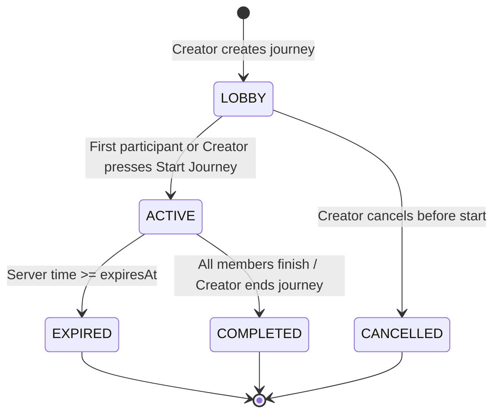
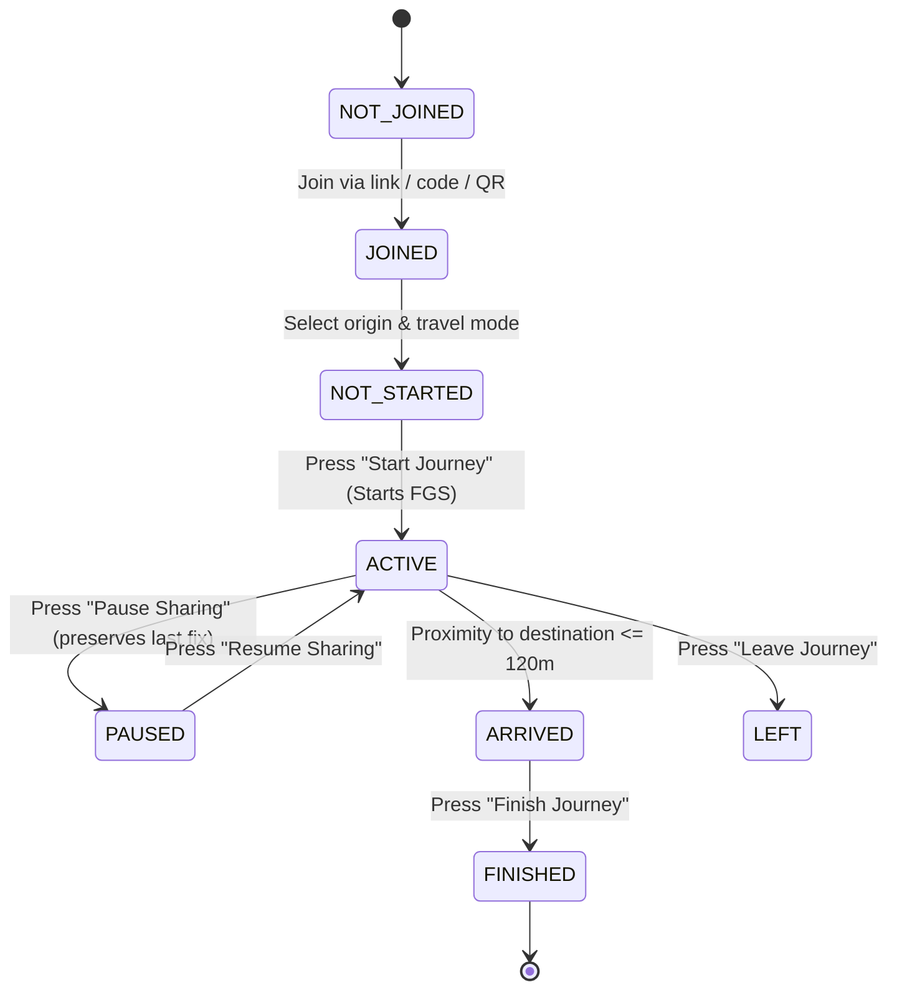

# SyncPoint Architecture & System Design

## 1. System Overview

SyncPoint is built on a "Journey, not tracking" paradigm. Location sharing is activated only inside an active journey, converging on one common destination.

```
                          +-----------------------+
                          |      Firebase         |
                          |-----------------------|
                          | Anonymous Auth        |
                          | Realtime Database     |
                          | FCM Notifications     |
                          | App Check             |
                          | Cloud Functions       |
                          +-----------+-----------+
                                      ^
                                      | live state / journey events
            +-------------------------+-------------------------+
            |                         |                         |
     +------+------+           +------+------+           +------+------+
     |  Traveler A |           |  Traveler B |           |  Traveler C |
     |  React Ntv  |           |  React Ntv  |           |  React Ntv  |
     |  MapLibre   |           |  MapLibre   |           |  MapLibre   |
     |  Kotlin FGS |           |  Kotlin FGS |           |  Kotlin FGS |
     +------+------+           +------+------+           +------+------+
            |                         |                         |
            +-------------------------+-------------------------+
                                      |
                                      v
                            +-------------------+
                            |  OSRM Routing API |
                            |  (Car/Bike/Walk)  |
                            +-------------------+
```

---

## 2. Journey State Machine



### Participant Lifecycle


---

## 3. Realtime Database Data Model

```
/users/{uid}
  profile: { name, username, phone, photoUrl }

/journeys/{journeyId}
  meta:
    journeyId: string
    name: string
    status: "LOBBY" | "ACTIVE" | "COMPLETED" | "EXPIRED" | "CANCELLED"
    creatorUid: string
    createdAt: number (server timestamp)
    startedAt: number | null
    expiresAt: number
    memberCount: number
    destination:
      lat: number
      lng: number
      placeId: string
      displayName: string
      address: string

  members/{uid}
    uid: string
    name: string
    username: string
    phone: string
    photoUrl: string
    role: "CREATOR" | "MEMBER"
    origin: { lat, lng, displayName }
    travelMode: "CAR" | "BIKE" | "WALK"
    sharingState: "NOT_STARTED" | "ACTIVE" | "PAUSED" | "ARRIVED" | "FINISHED" | "LEFT"
    joinedAt: number
    startedAt: number | null
    finishedAt: number | null

  live/{uid}
    lat: number
    lng: number
    heading: number
    speedMps: number
    batteryPct: number
    status: QuickStatusType
    lastUpdatedAt: number
    currentRoad: string
    distanceRemainingM: number
    etaEpochMs: number
    routeVersion: number
    isSharing: boolean

  routes/{uid}
    routeVersion: number
    profile: "driving" | "bike" | "foot"
    geometry: GeoJSON.LineString | polyline
    distanceM: number
    durationS: number
    steps: Array<RouteStep>
    updatedAt: number

  chat/{messageId}
    senderUid: string
    senderName: string
    text: string
    timestamp: number
    type: "TEXT" | "STATUS" | "EMERGENCY"

/joinCodes/{code}
  journeyId: string
  expiresAt: number
  status: "ACTIVE" | "EXPIRED"

/activeJourneyByUser/{uid}
  journeyId: string
  startedAt: number
  expiresAt: number
```

---

## 4. Native Android Location System (Kotlin)

- **`JourneyLocationService.kt`**: An Android `Service` declared with `android:foregroundServiceType="location"`. Started strictly when the traveler taps **Start Journey** while the UI is visible.
- **`AdaptiveSamplingPolicy.kt`**: Dynamically switches update cadences:
  - **Fast Movement** (>50 km/h): 2.5–3.0s interval.
  - **Normal Movement** (15–50 km/h): 5.0s interval.
  - **Slow Movement** (3–15 km/h): 8–10s interval.
  - **Stationary** (<3 km/h): 20–30s heartbeat.
- **Notification Drawer**: Displays live remaining distance, ETA, and quick actions (Pause / Finish).
